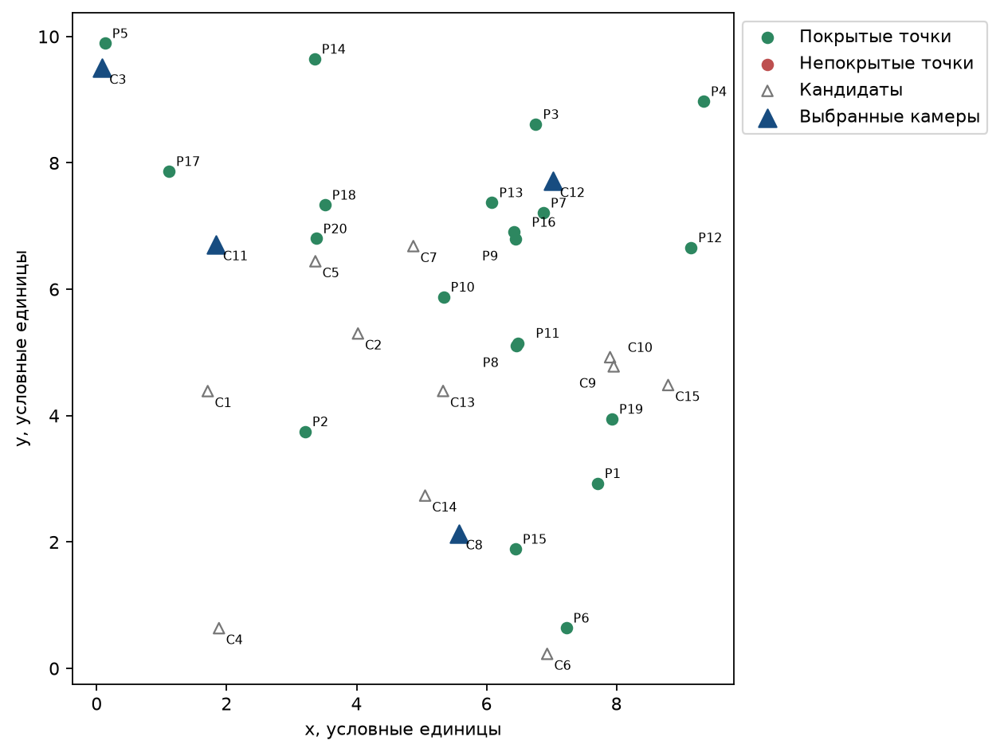
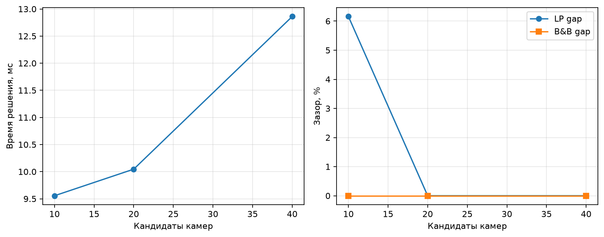

# ЛР3 — Размещение камер наблюдения

**Мягкий Арсений Сергеевич · группа 517 · вариант 12**  
Методы оптимизации. Линейное программирование, 2026.

MILP-модель выбирает камеры из 15 кандидатов для наблюдения за 20 точками кампуса при ограниченном бюджете. Цель — максимизировать суммарный приоритет покрытых точек. Решатель — открытый HiGHS, реализация — Python.

## Отчёты

- [Основной отчёт ЛР3](lab3/REPORT.md) — модель, LP-релаксация, сценарии, жадная эвристика, big-M и рост масштаба.
- [Задание со звёздочкой](lab3/STAR_FORMULATIONS.md) — сравнение двух эквивалентных MILP-формулировок и силы их LP-релаксаций.
- [Исходные данные](lab3/data.json) · [Решения CSV](lab3/results/solution.csv) · [Независимая проверка](lab3/results/verification.json) · [Логи HiGHS](lab3/results/logs/).

## Результаты

| Сценарий | Бюджет | Оптимум MILP | Оценка LP | Выбранные камеры |
|---|---:|---:|---:|---|
| Базовый | 47 | 94 | 94 | C3, C8, C11, C12 |
| Дефицитный | 37 | 80 | 87.5 | C5, C6, C10 |
| Стрессовый | 28 | 74 | 77.375 | C6, C10, C11 |

В базовом сценарии покрыты все 20 точек. Во всех трёх сценариях получен статус **Optimal**, конечный gap ветвления равен 0. Допустимость и значение цели проверяются отдельным кодом NumPy с допуском 1e-7.



При бюджете 37 компактная формулировка даёт верхнюю LP-оценку 87.5, агрегированная — 94, хотя обе имеют целочисленный оптимум 80. Подробное доказательство эквивалентности, измерения времени и опыт с M = 1000 приведены в задании со звёздочкой.

## Запуск

Проверено на **Python 3.12.14**. Все версии библиотек закреплены в [requirements.txt](requirements.txt), фактическое окружение — в [environment.json](environment.json). Готовые результаты уже включены в репозиторий.

Из корня репозитория создайте окружение:

```console
python -m venv .venv
```

Windows PowerShell:

```powershell
.\.venv\Scripts\python.exe -m pip install -r requirements.txt
.\.venv\Scripts\python.exe run.py
```

Linux или macOS:

```sh
.venv/bin/python -m pip install -r requirements.txt
.venv/bin/python run.py
```

В активированном окружении достаточно одной команды:

```console
python run.py
```

Повторно сгенерировать данные и выполнить все эксперименты:

```console
python run.py --regenerate
```

Параметры варианта: N = 14, Q = 1, Y = 26; V = 12, seed = 10114. Модель и данные хранятся отдельно. Данные и оптимумы воспроизводимы; время зависит от компьютера. При запуске отчёты и результаты обновляются.

## Структура

| Файл или папка | Содержание |
|---|---|
| [run.py](run.py) | Запуск всех экспериментов ЛР3 |
| [lab3/run.py](lab3/run.py) | Построение моделей, решение, независимые проверки и эвристика |
| [common.py](common.py) | Интерфейс HiGHS, работа с CSV/JSON и графиками |
| [generate_data.py](generate_data.py) | Генерация исходных данных и наборов для роста масштаба |
| [reports.py](reports.py) | Формирование отчётов из результатов |
| [lab3/results/](lab3/results/) | Планы LP/MILP, сценарии, проверки, графики и логи |

Исследованы 10, 20 и 40 кандидатов камер. Дополнительные наборы сохранены в `lab3/scale_*.json`.



Модель учебная: видимость определяется расстоянием, без препятствий и углов обзора. Это допущение и ограничения практического применения разобраны в отчёте.
