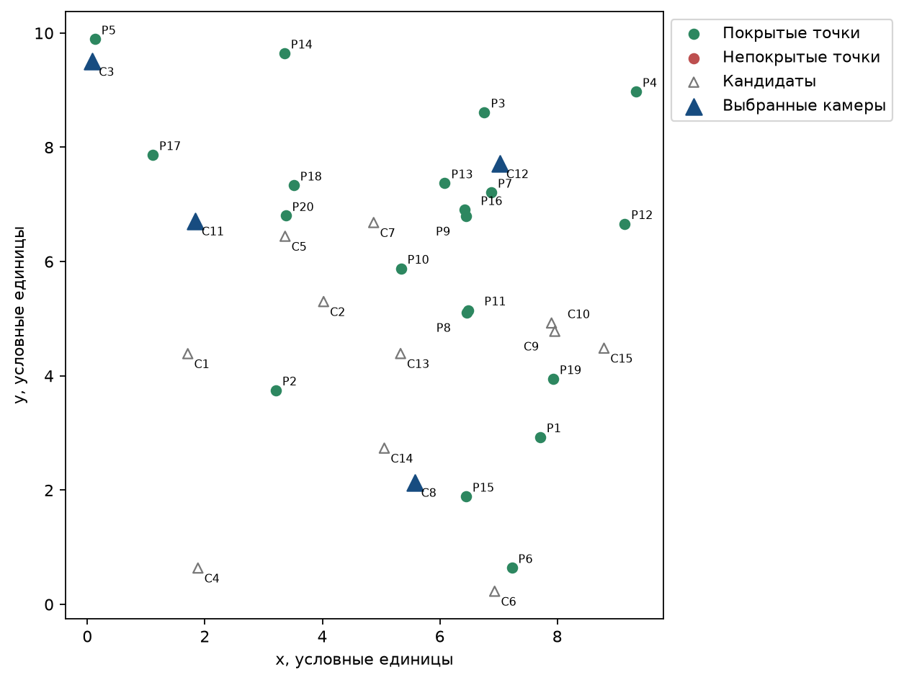
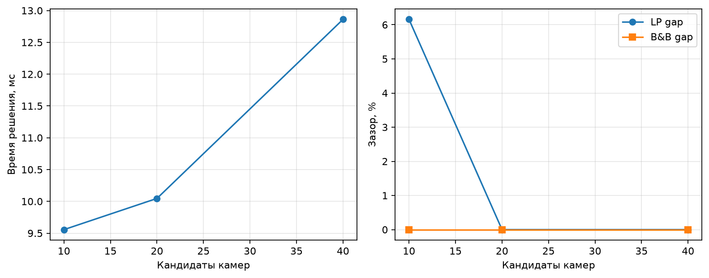

# Лабораторная работа 3
## Размещение камер наблюдения при бюджете

Мягкий Арсений Сергеевич. Группа 517. Порядковый номер N = 14, Q = 1, Y = 26. Вариант V = 1 + ((17·14 + 7·1 + 26) mod 20) = 12. Seed = 10000 + 100·1 + 14 = 10114.

Требуется выбрать камеры из 15 кандидатов, чтобы при ограниченном бюджете максимизировать суммарный приоритет наблюдения за 20 точками кампуса. При бюджете 47 ден. ед. оптимум равен 94 единицам приоритета: покрыты все точки. При сокращении бюджета состав камер и покрытие меняются.

## Исходные данные и допущения

I = {P1,…,P20} — контролируемые точки, J = {C1,…,C15} — кандидаты камер. c_j — стоимость установки, ден. ед.; B — бюджет, ден. ед.; w_i — безразмерный приоритет точки; a_ij ∈ {0,1} — видимость точки i из камеры j.

| Камера | Стоимость | Видимые точки |
|---|---|---|
| C1 | 19 | P2,P20 |
| C2 | 16 | P2,P8,P9,P10,P11,P13,P16,P18,P20 |
| C3 | 13 | P5,P14,P17 |
| C4 | 14 |  |
| C5 | 17 | P2,P9,P10,P13,P14,P16,P17,P18,P20 |
| C6 | 9 | P1,P6,P15 |
| C7 | 17 | P3,P7,P8,P9,P10,P11,P13,P16,P18,P20 |
| C8 | 11 | P1,P2,P6,P8,P11,P15,P19 |
| C9 | 17 | P1,P7,P8,P9,P10,P11,P12,P13,P15,P16,P19 |
| C10 | 7 | P1,P7,P8,P9,P10,P11,P12,P13,P16,P19 |
| C11 | 9 | P2,P17,P18,P20 |
| C12 | 14 | P3,P4,P7,P8,P9,P10,P11,P12,P13,P16 |
| C13 | 9 | P1,P2,P7,P8,P9,P10,P11,P13,P15,P16,P19,P20 |
| C14 | 14 | P1,P2,P6,P8,P10,P11,P15,P19 |
| C15 | 18 | P1,P8,P9,P11,P12,P19 |

Приоритеты точек P1–P20 по порядку: 8, 2, 5, 1, 8, 9, 7, 2, 5, 2, 1, 1, 9, 6, 4, 6, 6, 8, 2, 2. Их сумма 94.

Генерация: default_rng(10114) последовательно выбирает координаты 20 точек и 15 камер равномерно в квадрате [0,10)². Изначальный радиус каждой камеры 3.3 условной единицы. Для точки, не попавшей ни в один начальный круг, радиус ближайшей камеры расширяется до её расстояния плюс 1e-9. Затем вся матрица видимости пересчитывается. Стоимости выбираются целыми от 7 до 19, приоритеты от 1 до 9; B = round(0.23 Σc_j) = 47. Координаты, радиусы и матрица a сохранены в `data.json`; генератор — `../generate_data.py`.

Потенциальное покрытие задаётся расстоянием без препятствий; постоянные эксплуатационные расходы, углы обзора и взаимные помехи не учитываются. Веса аддитивны, повторное наблюдение точки не добавляет полезности. Непокрытые точки допустимы, поскольку задача максимизирует покрытие в рамках бюджета.

## Основная MILP модель

y_j ∈ {0,1} — установка камеры; z_i ∈ {0,1} — зачтённое покрытие точки. Непрерывных переменных в компактной формулировке нет; в расширенной модели ниже используются непрерывные назначения t_ij.

max F = Σ_i w_i z_i

Σ_j c_j y_j ≤ B; z_i ≤ Σ_j a_ij y_j для каждого i; y_j, z_i ∈ {0,1}.

Установка камеры неделима, поэтому условие y_j ∈ {0,1} нельзя заменить непрерывной LP без изменения смысла. Положительные веса гарантируют, что в оптимуме z_i = 1 для каждой видимой выбранными камерами точки. В LP-релаксации обе группы переменных заменяются на [0,1].

## Решение и независимая проверка

Расчёт выполнен в Python через highspy и открытый решатель HiGHS. Версии зафиксированы в `../requirements.txt` и `../environment.json`. LP решается симплекс-методом, presolve включён. Один поток, random_seed = 10114, предел времени 60 с; допуски допустимости и целочисленности решателя 1e-8. Для MILP заданы mip_rel_gap = 0 и mip_abs_gap = 0.

Статус Optimal означает найденный оптимум в пределах численных допусков. Infeasible означает отсутствие допустимого плана; Unbounded — неограниченную цель, что потребовало бы проверки пропущенных границ. При Time limit допустимый найденный план нельзя называть доказанно оптимальным: нужно указать лучшую границу и текущий gap. В приведённых экспериментах все основные задачи получили Optimal.

Независимые функции `verify` работают с NumPy и исходными данными, не обращаются к объекту HiGHS, отдельно пересчитывают ограничения и цель. Порог проверки всех ограничений — 1e-7. Неокруглённые решения хранятся в CSV и JSON; округление в отчёте служит только для чтения.

Основная модель имеет 35 бинарных переменных и 21 строку ограничений. HiGHS использует branch-and-cut, LP-релаксации и presolve. Для всех трёх сценариев статус Optimal и конечный gap ветвления 0. Это отличается от интегрального зазора между исходной LP-релаксацией и MILP.

Максимальное нарушение ограничений среди основных решений и эвристик — 0; ошибка пересчёта цели решателя — 0. Проверяются бюджет, границы, целочисленность и фактическая видимость каждой покрытой точки. Для расширенных моделей отдельно проверяются равенства назначений и все big-M-связки. Подробности — `results/verification.json` и `results/formulation_verification.json`. Намеренно дробный выбор, превышение бюджета и назначения на выключенные камеры отклонены.

## Сценарии и LP релаксация

Базовый бюджет 47; дефицитный floor(0.8B) = 37; стрессовый floor(0.6B) = 28. Округление вниз соответствует целым денежным единицам и явно входит в определение сценариев. Покрытие пересчитывается на тех же координатах и стоимостях.

| Сценарий | Бюджет | MILP | LP | LP gap % | Камеры |
|---|---|---|---|---|---|
| base | 47 | 94 | 94 | 0 | C3,C8,C11,C12 |
| deficit | 37 | 80 | 87.5 | 9.375 | C5,C6,C10 |
| stress | 28 | 74 | 77.375 | 4.56081 | C6,C10,C11 |

Интегральный зазор для задачи максимизации: 100·(F_LP−F_MILP)/|F_MILP|. В базе он нулевой, поскольку уже достигнуто полное покрытие. Нулевой зазор не означает, что любая LP-модель имеет целочисленный оптимум. В дефицитном сценарии LP даёт 87.5 вместо 80: непрерывная модель допускает покупку долей камер и частичное покрытие.

| Переменная | Значение |
|---|---|
| C3 | 0.75 |
| C6 | 0.25 |
| C7 | 0.75 |
| C8 | 0.75 |
| C10 | 0.25 |
| C11 | 0.25 |
| P3 | 0.75 |
| P5 | 0.75 |
| P12 | 0.25 |
| P14 | 0.75 |

Эти дробные компоненты дефицитного LP-решения физически нереализуемы как неделимые установки. Полные векторы LP и MILP каждого сценария представлены в `results/solution.csv`. Наборы зачтённых точек: в базе все P1–P20; при дефиците P1,P2,P6,P7,P8,P9,P10,P11,P12,P13,P14,P15,P16,P17,P18,P19,P20; в стрессе P1,P2,P6,P7,P8,P9,P10,P11,P12,P13,P15,P16,P17,P18,P19,P20. Бюджет не обязан расходоваться полностью, если добавление ещё одной камеры не улучшает цель или не помещается в остаток.

## Жадная эвристика и рост масштаба

Эвристика на каждом шаге выбирает доступную по остаточному бюджету камеру с максимальным отношением нового покрываемого приоритета к стоимости. При равенстве выбирается больший прирост, затем меньший индекс. Двойной подсчёт покрытых точек исключён. Алгоритм останавливается при отсутствии положительного доступного прироста и всегда соблюдает бюджет.

| Сценарий | MILP | Жадный | Зазор % | MILP мс | Жадный мс |
|---|---|---|---|---|---|
| base | 94 | 88 | 6.38298 | 10.027 | 0.1886 |
| deficit | 80 | 74 | 7.5 | 36.1316 | 0.229 |
| stress | 74 | 74 | 0 | 11.872 | 0.1244 |

Зазор эвристики равен 100·(F*−F_g)/F*. В базовом и дефицитном случаях она теряет часть покрытия, в стрессовом достигает оптимума. Время измеряется на том же входе; сборка модели исключена, запись журнала включена во время решателя. Числа в миллисекундах могут меняться между запусками.

| cameras | points | seconds | mip_gap_percent | integrality_gap_percent | nodes | utility | lp_bound |
|---|---|---|---|---|---|---|---|
| 10 | 13 | 0.0095559 | 0 | 6.15764 | 1 | 58 | 61.5714 |
| 20 | 26 | 0.0100462 | 0 | 0 | 1 | 144 | 144 |
| 40 | 53 | 0.0128611 | 0 | 0 | 1 | 236 | 236 |

Масштабный опыт использует 10, 20, 40 кандидатов, floor(4n/3) точек, seed = 10114+n и тот же генератор. Готовые файлы `scale_10.json`, `scale_20.json`, `scale_40.json` хранятся отдельно. Показаны время решения, исходный интегральный зазор и конечный gap ветвления. Последний во всех трёх опытах равен 0: увеличение размера не помешало доказать оптимальность. Это небольшие экземпляры, поэтому по ним нельзя утверждать экспоненциальный рост времени. При росте бюджета пропорционально числу камер некоторые большие экземпляры допускают полное покрытие и оказываются проще малого.

## Big M и две формулировки

Дополнительно вводится t_ij ∈ [0,1] только при a_ij = 1: доля покрытия точки, назначенная камере. Ограничения Σ_j t_ij = z_i и Σ_i t_ij ≤ M_j y_j связывают назначение с установкой. Достаточная константа M_j = Σ_i a_ij — число видимых данной камерой точек: больше единицы от каждой точки направить нельзя. При y_j = 0 назначения нулевые, при y_j = 1 разрешена вся потенциальная нагрузка. Для камеры без видимых точек M_j = 0.

Сравнение этой модели с компактной и опыт M = 1000 выполнены на дефицитном бюджете 37; подробное доказательство эквивалентности и результаты — в `STAR_FORMULATIONS.md`. Целочисленные оптимумы одинаковы, однако LP-оценка агрегированной модели слабее. При чрезмерном M дробные камеры дают полное LP-покрытие при расходах всего 0.184 ден. ед. Это показывает, почему M нельзя выбирать произвольно большим, даже если целочисленная задача остаётся эквивалентной.

## Вывод

Базовый бюджет позволяет покрыть все 20 точек; дефицитный и стрессовый снижают приоритет до 80 и 74. Выбранный набор неделимых камер можно реализовать при принятой геометрии, но предварительно нужно проверить реальные препятствия, монтаж и углы обзора. Компактная формулировка предпочтительна здесь по размеру и качеству LP-оценки; жадный выбор быстрее, но не всегда оптимален.

Методическая основа — предоставленный комплекс лабораторных работ А. А. Кузьмина, 2026, вариант 12. Интерфейс решателя: [официальные примеры highspy](https://ergo-code.github.io/HiGHS/dev/interfaces/python/example-py/); параметры и допуски: [документация HiGHS](https://ergo-code.github.io/HiGHS/dev/options/definitions/).
